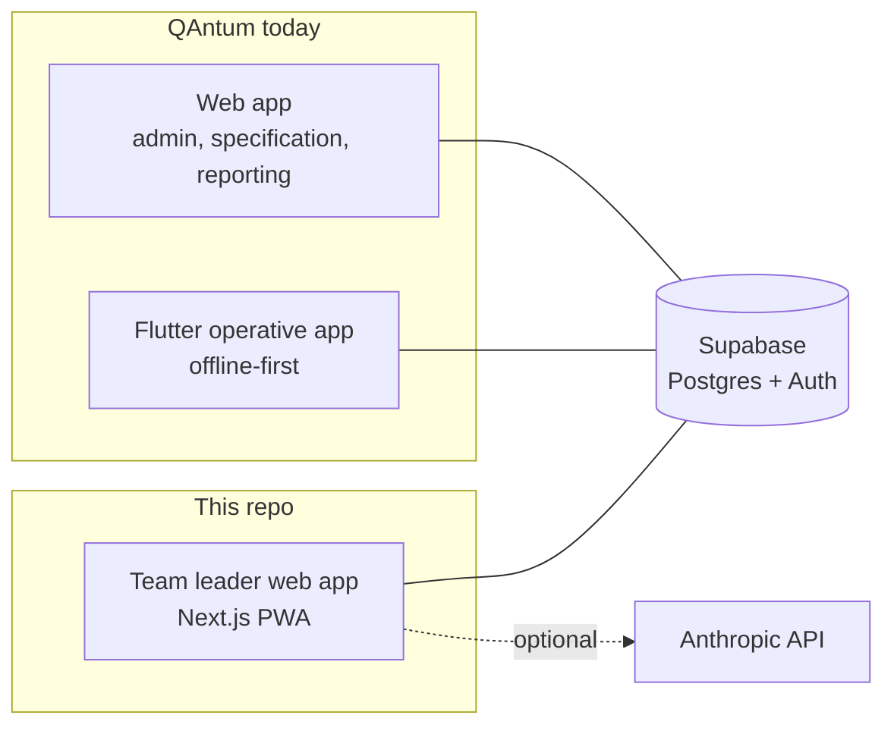
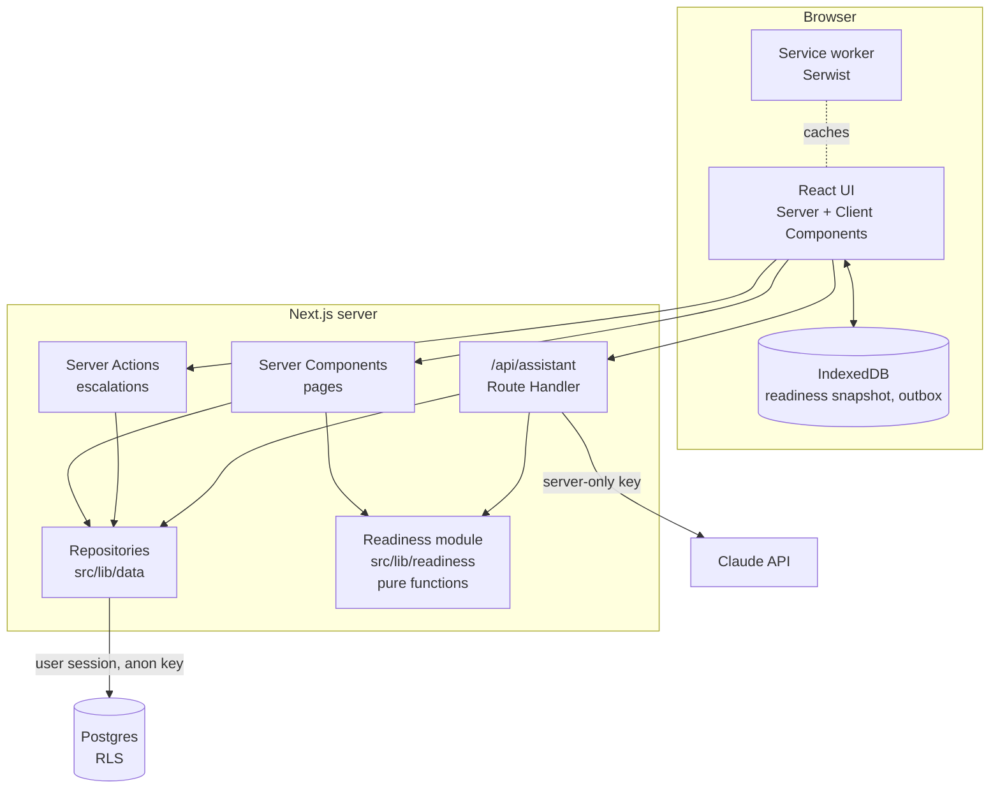
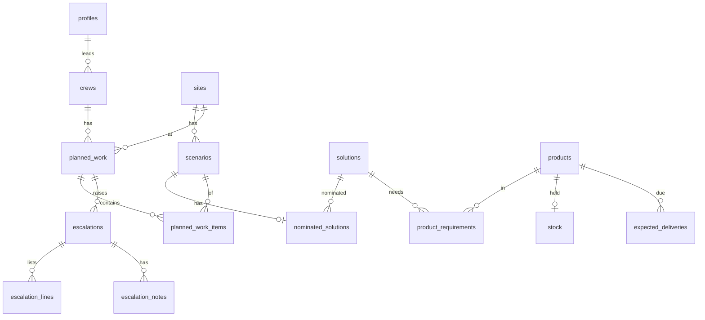

# Technical Design: Slice 1

Implements [`spec/slice-1.md`](spec/slice-1.md). Terms follow [`GLOSSARY.md`](../GLOSSARY.md). Decisions: [`adr/`](adr/).

## 1. Fit with QAntum



- **Same stack:** React, Next.js, Supabase and Vercel, as the brief requires. Flutter is not used, for the reasons in [ADR 0001](adr/0001-responsive-pwa-for-team-leaders.md).
- **Slice 1 is self-contained:** its own Supabase schema with SAMPLE data. In iteration 4 the sites, nominated solutions and planned work tables are replaced by views over QAntum's real data. The readiness module and UI do not change, because they depend only on the repository interfaces in §5.
- **Local first:** Supabase runs locally in Docker via the Supabase CLI; cloud Supabase and Vercel come at the end of the slice.

## 2. Architecture



| Layer           | Location                                               | Responsibility                                                                           |
| --------------- | ------------------------------------------------------ | ---------------------------------------------------------------------------------------- |
| Pages           | `src/app/**/page.tsx`                                  | Fetch data on the server and compose templates and organisms.                            |
| Server Actions  | `src/app/**/actions.ts`                                | Raise escalations, add notes, resolve. Validate input with Zod; check the user and role. |
| Assistant route | `src/app/api/assistant/route.ts`                       | Stream assistant answers; run read-only tools.                                           |
| Repositories    | `src/lib/data/`                                        | The only code that talks to Supabase. Typed interfaces, mockable in tests.               |
| Readiness       | `src/lib/readiness/`                                   | Allocation and readiness rules as pure functions. No I/O.                                |
| Catalogue       | `src/lib/catalogue/`                                   | CSV parsing and normalisation, used by the seed generator.                               |
| Offline         | `src/lib/offline/`                                     | IndexedDB snapshot and outbox, sync logic.                                               |
| UI              | `src/components/{atoms,molecules,organisms,templates}` | Atomic Design, per `CLAUDE.md` §4.                                                       |

## 3. User experience

Mobile-first, one column on phones and two columns (list and detail) from `lg`.

| Route                         | Persona         | Content                                                                                                           |
| ----------------------------- | --------------- | ----------------------------------------------------------------------------------------------------------------- |
| `/sign-in`                    | Anyone          | Two buttons: "Continue as Team Leader (SAMPLE)" and "Continue as Project Manager (SAMPLE)".                       |
| `/planned-work`               | Team leader     | Next 14 days grouped by date. Each card: site, crew, scenario count, readiness badge, "Relies on delivery".       |
| `/planned-work/[id]`          | Team leader     | Scenario rows with state and reasons; product table (needed, allocated, short); Escalate or View open escalation. |
| `/planned-work/[id]/escalate` | Team leader     | Pre-filled shortage lines, note field, "Draft with AI", Submit.                                                   |
| `/escalations`                | Team leader     | Open and Resolved escalations, plus any "Waiting to send".                                                        |
| `/inbox`, `/inbox/[id]`       | Project manager | Open escalations first; detail with notes and a resolution form.                                                  |
| `/offline`                    | Anyone          | Fallback for pages never visited.                                                                                 |

Cross-cutting:

- **Readiness badge** (atom): text plus icon for Ready (check), Short (cross), Unknown (question mark). Colour is secondary.
- **Data freshness bar** (molecule): "Data as of 08:42", turning into a warning after 24 hours. Always visible while offline.
- **Assistant drawer** (organism): opened from list and detail; shows "Needs a connection" or "Not available" states.
- **Empty and error states** for every list, and a not-found page for missing or inaccessible planned work.

## 4. Data model



| Table                  | Key columns                                                                                                                                                                                                                | Notes                                                   |
| ---------------------- | -------------------------------------------------------------------------------------------------------------------------------------------------------------------------------------------------------------------------- | ------------------------------------------------------- |
| `profiles`             | `id` (= auth user), `display_name`, `role` (`team_leader` \| `project_manager`), `is_sample`                                                                                                                               | Role drives routing and RLS.                            |
| `solutions`            | `internal_code` (text, unique), raw CSV columns, `shape`, `diameter_mm`, `width_mm`, `height_mm`, `substrate_type`, `substrate_thickness_mm`, `integrity_minutes`, `insulation_minutes` (nullable), `parse_flags` (text[]) | Raw and cleaned fields side by side.                    |
| `products`             | `id`, `sku`, `name`, `unit` (`each` \| `cartridge` \| `metre`), `is_sample`                                                                                                                                                |                                                         |
| `product_requirements` | (`solution_id`, `product_id`), `quantity_per_penetration` (numeric), `is_sample`                                                                                                                                           | Generated by the §4 rules in the spec.                  |
| `sites`                | `id`, `name`, `is_sample`                                                                                                                                                                                                  |                                                         |
| `scenarios`            | `id`, `site_id`, `label`, service, size, orientation, substrate, required ratings                                                                                                                                          |                                                         |
| `nominated_solutions`  | `scenario_id` (PK), `solution_id`, `nominated_at`                                                                                                                                                                          | Absent row means no nominated solution.                 |
| `crews`                | `id`, `name`, `team_leader_id`                                                                                                                                                                                             |                                                         |
| `planned_work`         | `id`, `crew_id`, `site_id`, `work_date`, `created_at`                                                                                                                                                                      |                                                         |
| `planned_work_items`   | (`planned_work_id`, `scenario_id`), `penetration_count` (> 0)                                                                                                                                                              |                                                         |
| `stock`                | `product_id` (PK), `quantity` (≥ 0), `updated_at`                                                                                                                                                                          | Absent row means no stock record.                       |
| `expected_deliveries`  | `id`, `product_id`, `quantity`, `expected_date`, `received_at`                                                                                                                                                             | Unreceived and past-dated means overdue.                |
| `escalations`          | `id` (UUID created on the device), `planned_work_id`, `raised_by`, `raised_at`, `state` (`open` \| `resolved`), `resolution`, `resolution_comment`, `resolved_by`, `resolved_at`, `shortage_cleared_at_sync`               | Partial unique index: one `open` per `planned_work_id`. |
| `escalation_lines`     | `escalation_id`, `product_id` (nullable), `quantity_short`, `reason`                                                                                                                                                       | Snapshot of the shortage at raise time.                 |
| `escalation_notes`     | `id`, `escalation_id`, `author_id`, `body` (≤ 1000), `created_at`                                                                                                                                                          |                                                         |
| `assistant_usage`      | `user_id`, `window_start`, `message_count`                                                                                                                                                                                 | Per-hour rate limit.                                    |

### Access rules (RLS)

Deny by default on every table; explicit column grants; no `select *` from the client.

| Table                                                       | Team leader                                   | Project manager                  |
| ----------------------------------------------------------- | --------------------------------------------- | -------------------------------- |
| Catalogue (`solutions`, `products`, `product_requirements`) | Read                                          | Read                             |
| `sites`, `scenarios`, `nominated_solutions`                 | Read for sites with their crews' planned work | Read                             |
| `crews`, `planned_work`, `planned_work_items`               | Read own crews only                           | Read                             |
| `stock`, `expected_deliveries`                              | Read                                          | Read                             |
| `escalations` and lines                                     | Read and insert own; no update                | Read all; update to resolve only |
| `escalation_notes`                                          | Read and insert on own escalations            | Read and insert                  |
| `assistant_usage`                                           | Own row via a function only                   | Own row via a function only      |

**Allocation across crews** needs every crew's demand, which a team leader cannot read. A `security definer` function, `allocation_demand(from_date)`, returns every future planned work's product demand: `planned_work_id`, `work_date`, `created_at`, `product_id`, `quantity`, and `is_own`. Rows that are not the caller's own carry no crew, site or scenario details. See [ADR 0002](adr/0002-cross-crew-allocation-via-demand-function.md).

## 5. Interfaces

### Readiness module (`src/lib/readiness`)

```ts
type ReadinessState = "ready" | "short" | "unknown";

interface DemandLine {
  plannedWorkId: string;
  workDate: string; // ISO date in the site's time zone
  createdAt: string;
  productId: string;
  quantity: number; // already rounded up per planned work
  isOwn: boolean;
}

interface Supply {
  stock: Map<string, number>; // productId -> on hand
  deliveries: { productId: string; quantity: number; expectedDate: string; received: boolean }[];
}

function computeDemand(items: PlannedWorkItemInput[]): DemandLine[]; // sum, then round up
function allocate(demand: DemandLine[], supply: Supply, today: string): Allocation[];
function deriveReadiness(
  plannedWork: PlannedWorkInput,
  allocations: Allocation[],
): PlannedWorkReadiness;
```

- `PlannedWorkReadiness` contains the worst state, plus per-scenario states, per-product lines (needed, allocated, short, relies on delivery) and typed `Reason` values. The UI renders the wording; the module returns no strings.
- Rules: date order, ties by `createdAt`; deliveries count only when `expectedDate < workDate` and the delivery is not overdue; Unknown when a nominated solution, product requirement or stock record is missing.

### Repositories (`src/lib/data`)

`PlannedWorkRepository`, `CatalogueRepository`, `SupplyRepository`, `EscalationRepository` and `AssistantUsageRepository`. Each is an interface with a Supabase implementation built on the request's user-scoped client, so pages, actions and assistant tools share one access path and RLS always applies. Tests use in-memory fakes.

### Server Actions

| Action              | Input (Zod)                              | Result                                                                                           |
| ------------------- | ---------------------------------------- | ------------------------------------------------------------------------------------------------ |
| `raiseEscalation`   | `id` (UUID), `plannedWorkId`, `note?`    | `created` \| `duplicate` (with existing ID) \| `alreadyOpen` (with open ID) \| validation errors |
| `addEscalationNote` | `escalationId`, `body`                   | `created` \| errors                                                                              |
| `resolveEscalation` | `escalationId`, `resolution`, `comment?` | `resolved` \| `forbidden` \| errors                                                              |

`raiseEscalation` recomputes readiness on the server, ignoring any shortage data sent by the client. It inserts with `on conflict (id) do nothing` so retries are idempotent, and sets `shortage_cleared_at_sync` when nothing is short any more.

## 6. Offline design

| Concern              | Approach                                                                                                                                                                                                                                                                 |
| -------------------- | ------------------------------------------------------------------------------------------------------------------------------------------------------------------------------------------------------------------------------------------------------------------------ |
| App shell            | Serwist precache (already scaffolded).                                                                                                                                                                                                                                   |
| Pages                | Network first with the `/offline` fallback.                                                                                                                                                                                                                              |
| Readiness data       | After each online render, the client stores the `PlannedWorkReadiness` snapshot and its `asOf` time in IndexedDB (`idb`). Offline, list and detail render from the snapshot.                                                                                             |
| Outbox               | Escalations raised offline go into an IndexedDB `outbox` store with their device-created UUID.                                                                                                                                                                           |
| Sync                 | On the `online` event, on app start and via Background Sync where supported, the outbox replays through `raiseEscalation`; a manual Retry button covers browsers without Background Sync. Items are removed only after a `created`, `duplicate` or `alreadyOpen` result. |
| Network-only actions | Resolving and the assistant are disabled offline, using `useOnlineStatus`.                                                                                                                                                                                               |

No conflict resolution is needed beyond idempotency: team leaders only create escalations offline; they never edit shared records.

## 7. Assistant design

| Aspect            | Decision                                                                                                                                                                                                                                                                 |
| ----------------- | ------------------------------------------------------------------------------------------------------------------------------------------------------------------------------------------------------------------------------------------------------------------------ |
| Model             | `claude-opus-5-5` (current default). Thinking cannot be disabled on this model; depth is set with `output_config.effort`, starting at `low` for chat and tuned with real questions.                                                                                      |
| SDK               | `@anthropic-ai/sdk`, server only. The tool runner (`client.beta.messages.toolRunner`) with Zod-validated tools (`betaZodTool`) drives the loop; responses are streamed to the browser.                                                                                   |
| Tools (read-only) | `list_planned_work`, `get_readiness(plannedWorkId)`, `get_shortages(plannedWorkId)`, `get_expected_deliveries(productId?)`, `draft_escalation(plannedWorkId)`. Each calls the repositories with the user's session, so the assistant sees exactly what the user can see. |
| Grounding         | The system prompt requires answers to come from tool results, to name planned work and products, to state `asOf`, and to say when data does not answer the question. It forbids calling any non-nominated solution compliant or suitable.                                |
| Tool choice       | `auto` only (forced tool choice is not supported on this model).                                                                                                                                                                                                         |
| Refusals          | The server-side fallback (`fallbacks: "default"`) is enabled so a safety decline is retried on another model; a final `refusal` stop reason shows a polite message. `max_tokens` stops are handled the same way.                                                         |
| Safeguards        | `AI_ENABLED` switch; `ANTHROPIC_API_KEY` required; 20 messages per user per hour via `assistant_usage`; answers capped with `max_tokens`; conversation kept client-side and trimmed to the last 10 turns.                                                                |
| Failure           | Network, rate-limit and API errors map to typed UI states; the rest of the app is unaffected.                                                                                                                                                                            |

## 8. Sample data pipeline

```
docs/solutions-excerpt.csv
  -> src/lib/catalogue/parse.ts       (parse and normalise; unit-tested)
  -> scripts/generate-seed.ts         (catalogue + SAMPLE products, requirements, site, crews, planned work, supply)
  -> supabase/seed.sql                (committed, deterministic, dates relative to load day via current_date)
```

`pnpm db:reset` runs the migrations and `seed.sql`. Demo users are created by the seed through Supabase's auth schema, with passwords set from `.env.local` (not committed).

## 9. Local environment and CI

| Concern        | Approach                                                                                                                                                                        |
| -------------- | ------------------------------------------------------------------------------------------------------------------------------------------------------------------------------- |
| Local services | `pnpm db:start` (Supabase CLI in Docker), `pnpm db:reset`, `pnpm dev`.                                                                                                          |
| Environment    | `.env.local` holds the local Supabase URL and anon key printed by the CLI, and optionally `ANTHROPIC_API_KEY`. `.env.example` lists them all.                                   |
| CI             | Starts local Supabase, runs migrations and seed, then lint, typecheck, unit tests, RLS tests, build and E2E. The Vercel deploy job is skipped until `DEPLOY_ENABLED` is `true`. |

## 10. Security

- RLS on every table, plus role checks in every Server Action; the client is never trusted for IDs or roles.
- The service role key is not used by the app. The only privileged code is the narrow `allocation_demand` function (ADR 0002).
- The Anthropic key is server-only; assistant tools reuse the user-scoped repositories.
- Escalation notes and assistant input are length-limited and rendered as text, never as HTML.

## 11. Trade-offs

| Decision                 | Chosen                                    | Rejected option               | Why                                                                                      |
| ------------------------ | ----------------------------------------- | ----------------------------- | ---------------------------------------------------------------------------------------- |
| Readiness logic location | TypeScript pure functions                 | Postgres functions            | Easier to test exhaustively and reuse in the assistant; data volumes per user are small. |
| Cross-crew allocation    | Narrow `security definer` demand function | Service role key in the app   | Least privilege; other crews' details never leave the database.                          |
| Offline data             | Readiness snapshot in IndexedDB           | Full offline database replica | Team leaders only read readiness and create escalations offline.                         |
| Assistant loop           | SDK tool runner                           | Hand-written loop             | Less code to own; Zod validation of tool input.                                          |
| Sample data              | Generated, committed `seed.sql`           | Hand-written fixtures         | Reproducible; rules are tested; the CSV stays the source.                                |
| Auth                     | Demo personas on real Supabase Auth       | No auth                       | Keeps RLS honest for the demo.                                                           |
